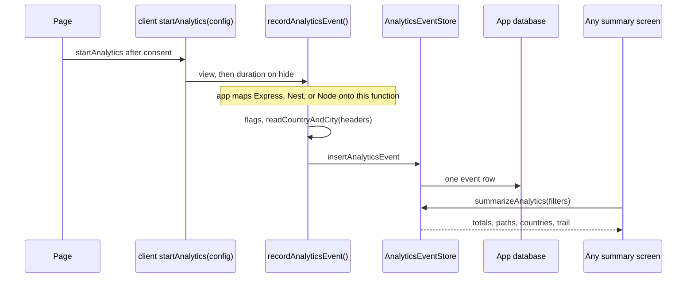
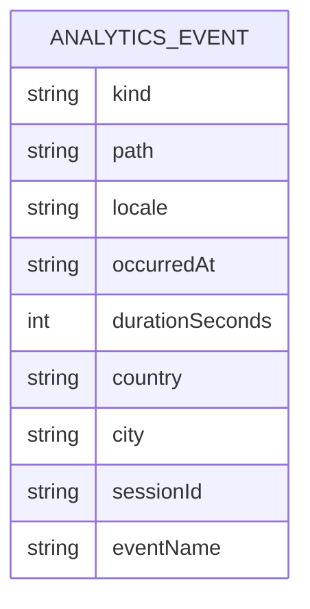

# RFC: Analytics SDK

Status: approved · Date: 2026-10-25 · Type: feat · PRD: none: scope agreed in conversation · Epic: AN
Depends on: none · Unblocks: installing the package in a client site (a later work item, not this one)

## Summary

Three client sites need the same analytics, with different modules turned on. Totals and time on page are the base. Country, city, a session trail, and named clicks are optional. The data lives in the project's own database. There is no second analytics server.

The product is a framework-agnostic toolkit. A client script records visits from a config object. A server function accepts those events and writes them through a storage port. Postgres is the first storage adapter. Express, NestJS, or plain Node mount the same function. Payload is one more adapter, for projects that already use it: it stores rows through that project's database and adds an admin screen. A project that never installs the Payload entry never loads Payload.

This file is the design. The package is built and run in a new empty folder, with its own git repo. Nothing in that folder imports this site, and this site does not gain package source.

## Current state

- Nothing in this repo records page views. `src/lib/analytics/` does not exist. The architecture rule names a `track()` port and leaves the vendor open.
- The sites that need this run Next.js with Payload and one Postgres database. That is a consumer, not the shape of the package.
- A separate Umami process was rejected. It is another server. These projects want tables and a function they call.
- Country and city are available on Vercel as request headers. Other hosts expose them differently, or not at all. The core must not assume Vercel.
- The package does not exist yet. There is no folder, no `package.json`, and no git history for it. AN-1 starts from an empty directory, outside this repo.

## Decisions

1. **The core has no framework.** `@<scope>/analytics-sdk` exports the event row, the module flags, and `AnalyticsEventStore`. It does not import Payload, Express, Nest, Next, or `pg`.
2. **The client is its own entry.** `@<scope>/analytics-sdk/client` is the browser script. `startAnalytics(config)` is the whole integration: views, time on page, the session cookie, and named clicks, all decided by the config. The page does not assemble a beacon by hand.
3. **Ingest is a function, not a Payload route.** `@<scope>/analytics-sdk/server` exports `recordAnalyticsEvent(request, deps)`. The input is a plain body plus headers. Express, NestJS, a Next route, or a Payload endpoint each adapt their request to that input in a few lines. The package does not depend on those frameworks.
4. **Storage is a port.** `AnalyticsEventStore` is `insertAnalyticsEvent`, `recordAnalyticsDuration`, and `summarizeAnalytics`. `@<scope>/analytics-sdk/postgres` is the durable adapter and owns the SQL table. Any other database is a later adapter of the same interface. The in-memory store is for tests.
5. **Payload is an optional adapter.** `@<scope>/analytics-sdk/payload` is the only entry that imports `payload`. It implements `AnalyticsEventStore` with the Local API, registers a collection that matches the core row, and renders `summarizeAnalytics` inside the admin shell. Projects on Express or Nest never install it.
6. **One row shape everywhere.** A view and a named click share the row. The session trail is rows with the same `sessionId`, ordered by time. Nullable columns exist even when a module is off, so turning a flag on does not change the schema.
7. **Modules are flags.** Views are always on. `country`, `city`, `sessions`, and `clicks` default off. Off means the client does not send that data, the server drops it if a client sends it anyway, and any screen built on `summarizeAnalytics` omits that section.
8. **Geo is supplied by the host.** The client never sends a country or a city. `recordAnalyticsEvent` calls an optional `readCountryAndCity(headers)` the app passes in. `readVercelCountryAndCity` is the helper for Vercel. Another host passes a different function. The IP is never stored.
9. **No replay and no global click listener.** Clicks are elements marked `data-analytics="cta_clicked"`, and only when `clicks` is on. A listener on every click is out.
10. **Consent stays in the app.** `startAnalytics({ enabled: false })` sends nothing. The package has no banner.
11. **Private npm first.** One package, five entries. Restricted to the agency scope. Public release waits until the three sites use it.
12. **The package lives in its own empty folder.** Implementation does not happen under `src/` here. AN-1 creates a new directory and a new git repo. The first thing that runs there is the package's own test script. Once `recordAnalyticsEvent` and the Postgres store exist, a `playground/` inside that same folder serves one HTML page and a Node process, so the client, the server, and the database can be exercised with no Payload site and no copy of this template. Client sites install the published package later. They are not the place it is developed.
13. **The package is `@<scope>/analytics-sdk`.** That is the product name: an SDK a project installs. Function names still say the action, so a call reads on its own: `startAnalytics`, `recordAnalyticsEvent`, `summarizeAnalytics`, `recordNamedClick`, `readVercelCountryAndCity`. `page` is not part of the public names. A view is one event this SDK records, with duration, country, a session trail, and named clicks. Staff audit data, leads, and revenue stay outside this package.

## Flows



Payload, when a project uses it, sits in two boxes of this diagram and nowhere else. Its endpoint is a wrapper around `recordAnalyticsEvent`. Its admin screen is a wrapper around `summarizeAnalytics`. Its store is one `AnalyticsEventStore`.

## Requirements coverage

| Need | Design | Ticket |
|---|---|---|
| Start in an empty folder, separate from this site | New directory, its own git repo, its own scripts | AN-1 |
| Event model and storage port, no framework | Core and the in-memory store | AN-2 |
| A frontend script driven by config | `./client` and `startAnalytics(config)` | AN-3 |
| Use it from Node, Express, or Nest, in the app's own database | `recordAnalyticsEvent`, the Postgres store, and `playground/` in the package folder | AN-4 |
| Optional Payload admin, for projects that already run Payload | `./payload` adapter | AN-5 |
| Install it from npm | Private publish and the README | AN-6 |

There is no public visitor screen. A summary screen is whatever the app builds from `summarizeAnalytics`. The Payload admin page is the one screen this package ships, and only in the Payload entry.

## Event row

The core owns this shape. Postgres stores it as a table. The Payload collection, if used, copies it. Neither adapter invents a second shape.



Table name `analytics_event`.

| Field | Required | Notes |
|---|---|---|
| `kind` | yes | `view` or `click` |
| `path` | yes | Path only, max 2048. No origin, no query string |
| `locale` | no | BCP 47, max 35, from the client config |
| `occurredAt` | yes | ISO time from the server clock |
| `durationSeconds` | no | Views only. 0 to 1800 |
| `country` | no | ISO code. Null when `country` is off or `readCountryAndCity` returns nothing |
| `city` | no | Max 80. Null when `city` is off |
| `sessionId` | no | Max 36. Null when `sessions` is off |
| `eventName` | no | Max 64. Set for clicks. Null for views |

`summarizeAnalytics` returns:

- `totalViews`, `averageDurationSeconds`
- `byPath`: path, views, average duration
- `byCountry` when `country` is on, otherwise the field is absent
- `byCity` when `city` is on, otherwise absent
- `sessions`: id, startedAt, page count, when `sessions` is on
- one session's events in time order, when the query includes a `sessionId` and `sessions` is on
- `byEventName` when `clicks` is on, otherwise absent

## Access

`recordAnalyticsEvent` is the only writer. `summarizeAnalytics` is a function the application calls on the server. The package does not expose a public query API. The application decides who may open its summary screen.

The Payload adapter adds collection access on top of that, because Payload would otherwise publish a REST API for the table. Read requires an authenticated user. Create, update, and delete are denied. The adapter's endpoint writes with `overrideAccess: true`. A project may pass its own `read` function.

| Payload collection | read | create | update | delete |
|---|---|---|---|---|
| `analytics-events` | authenticated user, or the project's `read` | never | never | never in v1 |

Anonymous REST cannot list or create those rows. That test belongs to AN-5 only.

## Hooks and revalidation

None. An event does not change a public page.

## Migrations and data

The Postgres adapter ships the `CREATE TABLE` statement for `analytics_event`. The application runs it with the rest of its schema.

A Payload project uses the Payload adapter instead of applying that SQL itself. The plugin adds the collection, and the project generates a Payload migration. The package does not ship a Payload migration snapshot. The two adapters must not both create the table in the same database.

No backfill.

## How an application mounts it

The client posts to whatever URL the application configured. The package does not own that URL.

| Piece | Role |
|---|---|
| `startAnalytics(config)` in the browser | Sends a view on load and on later client-side navigations. Sends duration with `sendBeacon` when the page hides. |
| `recordAnalyticsEvent(request, deps)` on the server | Validates one request and calls the store. Handles a new view, a duration update, and a click. |
| `summarizeAnalytics(query, modules)` on the store | Returns the summary. The application renders it. |

Express and Nest are documented wrappers, not dependencies:

```ts
app.post('/analytics/events', async (req, res) => {
  const result = await recordAnalyticsEvent(
    { body: req.body, headers: req.headers },
    { store, options, readCountryAndCity: readVercelCountryAndCity },
  )
  res.status(result.status).json(result.body)
})
```

A Nest controller method calls `recordAnalyticsEvent` the same way and returns `result.body`. A Node server does too. `readCountryAndCity` is optional. Omit it and country and city stay null. `readVercelCountryAndCity` is the helper for Vercel.

The Payload plugin, in AN-5, mounts the same `recordAnalyticsEvent` on a Payload endpoint and mounts `summarizeAnalytics` on an admin view at `/admin/analytics`. That view is a server component in the admin shell. Filters are the query string: from, to, country, path. Date range defaults to the last 7 days. A module that is off has no section. A session row links to `?session=<id>`.

## Client

`startAnalytics` is the integration. Calling it once is enough.

```ts
startAnalytics({
  endpoint: '/analytics/events',
  enabled: hasConsent,
  locale: 'en',
  sessions: false,
  clicks: false,
})
```

- `enabled: false` installs nothing. No timer, no cookie, no listener.
- A view is sent on load. Further views are sent when `history.pushState`, `replaceState`, or `popstate` changes the path, so a single-page app is covered without a framework adapter.
- Duration is sent for the current view when the page hides, capped at 30 minutes.
- `sessions: true` stores a random id in a first-party cookie named `analytics_session` (`SameSite=Lax`, one year). The script sends that id. The server still drops it when the server-side `sessions` flag is off.
- `clicks: true` listens for clicks on `[data-analytics]`. The attribute value is the event name (`cta_clicked`). Clicks on anything else are ignored. `recordNamedClick('cta_clicked')` records the same way for clicks that have no element.

The client entry imports none of the server, Postgres, or Payload entries.

## i18n

The client sends the locale the application passes. Rows are not translated content. The Payload screen's labels are English in v1.

## SEO and analytics

This package is the analytics. It does not change metadata, the sitemap, or JSON-LD. It stores click names the application chose. It does not define a catalog of names.

## Editor experience

Only the Payload adapter has a screen, and it is one page rather than a collection form. Editors do not create rows. The collection is hidden from the nav.

Any other framework renders `summarizeAnalytics` itself. The package does not ship an Express or Nest dashboard in v1.

## Critical code

```ts
export const AnalyticsEventKind = {
  VIEW: 'view',
  CLICK: 'click',
} as const
export type AnalyticsEventKind = (typeof AnalyticsEventKind)[keyof typeof AnalyticsEventKind]

export interface AnalyticsModules {
  country: boolean
  city: boolean
  sessions: boolean
  clicks: boolean
}

export interface AnalyticsServerOptions {
  enabled: boolean
  modules: AnalyticsModules
}

export interface AnalyticsClientConfig {
  endpoint: string
  enabled: boolean
  locale?: string
  sessions: boolean
  clicks: boolean
}

export interface NewAnalyticsEvent {
  kind: AnalyticsEventKind
  path: string
  locale: string | null
  durationSeconds: number | null
  country: string | null
  city: string | null
  sessionId: string | null
  eventName: string | null
}

export interface StoredAnalyticsEvent extends NewAnalyticsEvent {
  id: string
  occurredAt: string
}

export interface AnalyticsSummaryQuery {
  from: string
  to: string
  country: string | null
  path: string | null
  sessionId: string | null
}

export interface AnalyticsEventStore {
  insertAnalyticsEvent(event: NewAnalyticsEvent, occurredAt: string): Promise<StoredAnalyticsEvent>
  recordAnalyticsDuration(id: string, durationSeconds: number): Promise<void>
  summarizeAnalytics(
    query: AnalyticsSummaryQuery,
    modules: AnalyticsModules,
  ): Promise<AnalyticsSummary>
}

export interface AnalyticsEventRequest {
  body: unknown
  headers: Record<string, string | string[] | undefined>
}

export interface RecordAnalyticsEventDeps {
  store: AnalyticsEventStore
  options: AnalyticsServerOptions
  readCountryAndCity?: (
    headers: AnalyticsEventRequest['headers'],
  ) => { country: string | null; city: string | null }
  now?: () => string
}
```

`recordAnalyticsEvent` returns `{ status, body }`. `enabled: false` returns 204 and writes nothing. A country or city in the body is ignored. `recordAnalyticsDuration` ignores values outside 0 to 1800 and ignores ids that are not views.

`path` must start with `/` and must not contain a scheme. Query strings are stripped. `eventName` must match `^[a-z0-9_]+$`.

AN-1 fails the build if `src/index.ts`, `src/client/`, `src/server/`, or `src/postgres/` can import `payload`. `payload` and `pg` are optional peer dependencies of the entries that use them.

## Security and privacy

- Stored data: path, locale, time, duration, country code, city name, a random session id, and a click name. No IP, no user agent, no form text, no email.
- The session id is a visitor identifier. The client creates it only when `sessions` is on and `enabled` is on. The server stores it only when the server flag is on.
- Country and city come from the host's `readCountryAndCity` function. Together with the timestamp they can identify a person. `city` defaults off.
- The client cannot set `occurredAt`, `country`, or `city`.
- Duration is capped so a forgotten tab cannot store a multi-day number.
- Retention is not automated in v1. The table grows with traffic. A delete-older-than job is out of scope.

## Performance

The client is a small script. It sends one request on load and one `sendBeacon` on hide, plus one request when the path changes. It does not load a third-party script. `summarizeAnalytics` is an aggregate over a date range.

## Testing strategy

- In-memory store: flags drop country, city, session, and click fields. Duration is capped. Summary groups by path and country.
- `recordAnalyticsEvent`: `enabled: false` writes nothing. A country in the body is ignored. `readCountryAndCity` is stored only when the module is on.
- Client: `startAnalytics({ enabled: false })` does not register listeners. With `clicks` off, a `data-analytics` click sends nothing. With `clicks` on, only that element sends.
- Postgres adapter: `insertAnalyticsEvent` and `summarizeAnalytics` against a test database.
- Payload adapter: an anonymous REST call cannot list or create `analytics-events`.

No Playwright suite in this package.

## Where the work runs

The folder starts empty. It is not a workspace member of this repo, and it does not contain a copy of this site.

```
analytics-sdk/
  package.json          the published package
  src/                  core, client, server, postgres, payload
  playground/           one static page + one Node server, for local running
  README.md
```

`playground/` depends on the package through the workspace, not through npm. Its server calls `recordAnalyticsEvent` and the Postgres store. Its page calls `startAnalytics`. Opening that page writes a row. That is the run loop until a real site installs the published build. The playground is not published.

This repo keeps this RFC only. Ticket branches for AN-1 through AN-6 are branches of the new repo.

## Rollout

1. Create the empty folder and its git repo (AN-1). Develop and run the package there.
2. Publish the private package from that repo (AN-6).
3. A later work item, per site, chooses an adapter. A Payload site installs `./client` and `./payload`, generates a migration, and calls `startAnalytics` after consent. An Express or Nest service installs `./client`, `./server`, and `./postgres`, runs the SQL, and mounts `recordAnalyticsEvent`.
4. Flags are chosen per project. Totals only, or totals plus country, or the session trail.

No content for an editor to type. No redirects.

## Ticket breakdown

| Order | Ticket | Units (est. files) | Depends on | Covers |
|---|---|---|---|---|
| 1 | AN-1 | repo (~14) | - | New empty folder outside this site, its own git repo, TypeScript, test runner, build. Entries: `.`, `./client`, `./server`, `./postgres`, `./payload`. Boundary test so only `./payload` can import `payload` |
| 2 | AN-2 | repo (~10) | AN-1 | Event row, module flags, `AnalyticsEventStore`, in-memory store, `summarizeAnalytics` |
| 3 | AN-3 | repo (~8) | AN-2 | `./client`: `startAnalytics(config)`, views, duration, session cookie, `data-analytics` clicks |
| 4 | AN-4 | repo (~14) | AN-2 | `recordAnalyticsEvent`, `readVercelCountryAndCity`, Postgres `AnalyticsEventStore` and its `CREATE TABLE`, plus `playground/` so the folder can be run on its own |
| 5 | AN-5 | repo (~10) | AN-2, AN-4 | Payload adapter: collection matching the row, endpoint wrapping `recordAnalyticsEvent`, admin screen over `summarizeAnalytics` |
| 6 | AN-6 | repo (~6) | AN-3, AN-4, AN-5 | Private npm publish. README for the client, for Express and Nest, and for Payload |

AN-3 and AN-4 can be built in parallel after AN-2. AN-5 waits on the core and on `recordAnalyticsEvent`, not on the client. AN-6 waits until the client, the Postgres path, and the Payload adapter all exist. Review per unit: AN-2 and AN-4 (the port and the table). The runnable check is the playground in the package folder. This website repo is not where those branches land.

## AI setup changes

Proposal, not a ticket in this package. When the first site installs it, point that site's analytics rule at `@<scope>/analytics-sdk`. The site calls `startAnalytics` and `recordNamedClick` from the client entry. The site's own `track()` port delegates to `recordNamedClick`. Payload projects add the Payload adapter. Do not add Umami.

## Alternatives considered

- **A Payload plugin as the product.** Rejected. Express and Nest projects would be unable to use it, and the event model would be a CMS collection.
- **Umami on a small VPS.** Rejected for v1. It is a second server and a second database. Another `AnalyticsEventStore` could wrap it later without changing the client.
- **A separate npm package for the client.** Rejected. A second package means a second version to keep in lockstep. A `./client` entry keeps the browser bundle free of `pg` and `payload`.
- **Hiding unpaid modules by omitting the code.** Rejected. The client owns the repo. The contract decides which flags are on.
- **`page-analytics`.** Rejected. The product is not limited to a page view, and `page` collides with a Payload page and with the admin screen. `@<scope>/analytics-sdk` is the package name. `@<scope>/analytics` alone is still too broad.

## Risks and open questions

- **Open: the npm scope.** Publishing needs an organization scope the agency controls. Recommendation: a private scope you already use. AN-6 fills the name. Nothing else waits on the string.
- The Payload admin view must match Payload 3.92's root view API. The implementer checks the installed types. That risk sits in AN-5 and does not affect the other entries.
- City plus timestamp can identify a person in a small place. Default is off.
- v1 has no retention job. Revisit when a table is large enough to matter.
